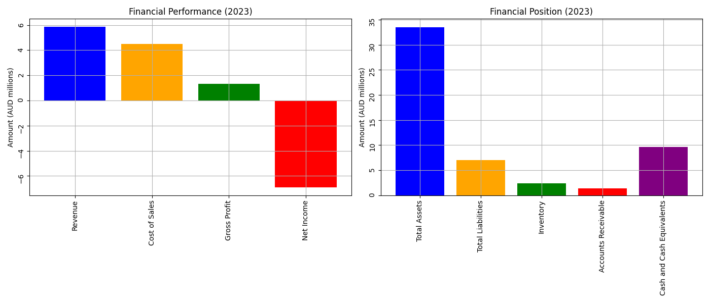
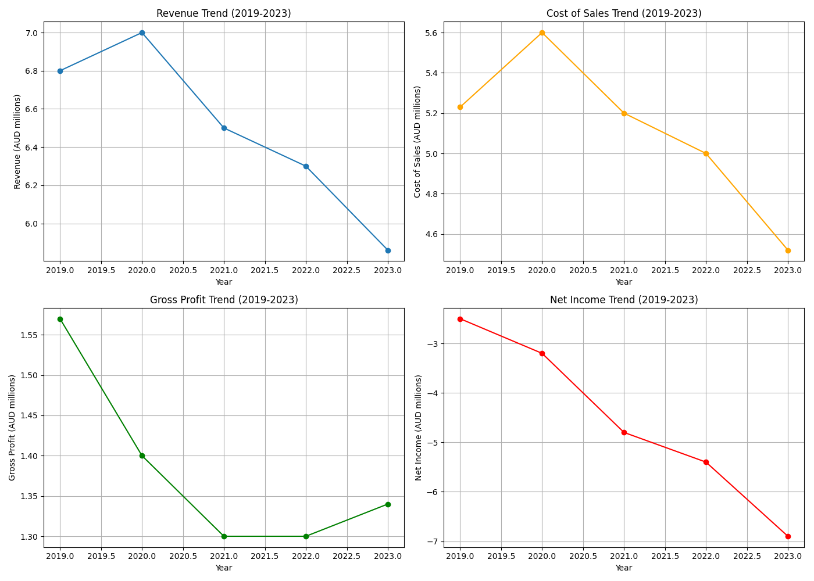
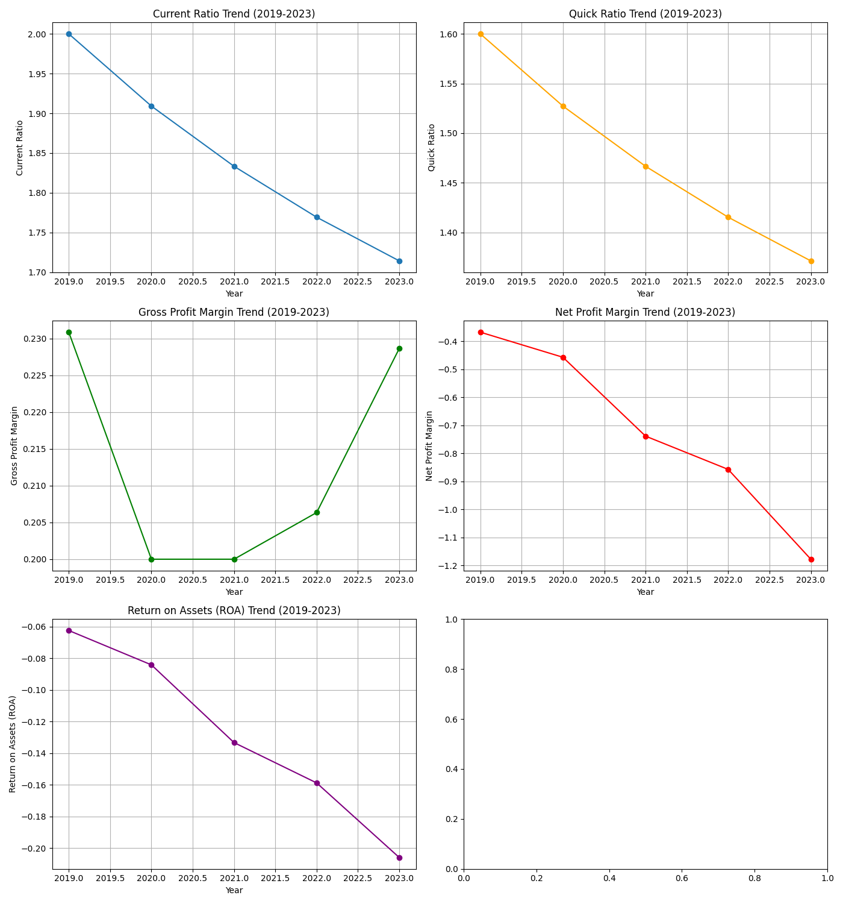

---
editor_options:
  markdown:
    wrap: sentence
output:
  word_document: default
  pdf_document: default
---

# **Executive Summary**

This report analyzes the financial performance of Australian Dairy Nutritionals Group (ADNG) over the past five years using vertical analysis, trend analysis, and ratio calculations.
The analysis focuses on liquidity, efficiency, profitability, and market prospects to provide insights into ADNG's financial health.

# **Introduction**

Australian Dairy Nutritionals Group (ADNG) is a key player in the dairy industry, known for its high-quality nutritional products.
This report evaluates ADNG's financial performance over the last five years through structured analysis, including vertical analysis, trend analysis, and ratio calculations.

# **Financial Analysis**

## **1. Vertical Analysis**

The vertical analysis of the most recent year's annual report identifies the top five contributing items to ADNG's financial performance and position.

### **Financial Performance (2023):**

-   **Revenue**: AUD 5.86 million
-   **Cost of Goods Sold (COGS)**: AUD 4.52 million
-   **Gross Profit**: AUD 1.34 million
-   **Net Income**: AUD -6.9 million
-   **Inventory**: AUD 2.4 million

**Explanation:** - Revenue decreased, indicating potential market challenges.
- COGS decreased proportionately with revenue, maintaining a stable gross margin.
- Gross profit remained stable, showing consistent cost control.
- Net income worsened, indicating increased expenses or decreased operational efficiency.
- Inventory levels have been managed efficiently.

### **Financial Position (2023):**

-   **Total Assets**: AUD 33.5 million
-   **Total Liabilities**: AUD 7.0 million
-   **Current Assets**: AUD 12.0 million
-   **Current Liabilities**: AUD 7.0 million
-   **Accounts Receivable**: AUD 1.4 million

**Explanation:** - Total assets slightly decreased, indicating asset liquidation or depreciation.
- Total liabilities increased, suggesting higher borrowing or obligations.
- Current assets grew, indicating better short-term financial health.
- Current liabilities increased, indicating higher short-term debt.
- Accounts receivable increased, reflecting extended credit terms or collection challenges.

### **Key Takeaways:**

-   ADNG's revenue and net income have declined.
-   The company maintains stable gross profit and inventory levels.
-   Total liabilities and accounts receivable have increased, reflecting potential financial pressures.

## **2. Trend Analysis**

### **Revenue Trend (2019-2023):**

-   Revenue decreased from AUD 6.8 million in 2019 to AUD 5.86 million in 2023.

### **COGS Trend:**

-   COGS decreased from AUD 5.23 million in 2019 to AUD 4.52 million in 2023.

### **Gross Profit Trend:**

-   Gross profit fluctuated slightly but remained stable around AUD 1.3-1.57 million.

### **Net Income Trend:**

-   Net income worsened from AUD -2.5 million in 2019 to AUD -6.9 million in 2023.

### **Inventory Trend:**

-   Inventory increased from AUD 2.0 million in 2019 to AUD 2.4 million in 2023.

### **Key Takeaways:**

-   ADNG's revenue and net income have shown a declining trend.
-   Gross profit has remained stable.
-   Inventory management has been effective.

## **3. Ratio Analysis**

### **Liquidity and Efficiency:**

-   **Current Ratio**: Decreased from 2.00 in 2019 to 1.71 in 2023.
-   **Quick Ratio**: Decreased from 1.60 in 2019 to 1.37 in 2023.
-   **Inventory Turnover Ratio**: Decreased from 2.62 in 2019 to 2.04 in 2023.
-   **Accounts Receivable Turnover Ratio**: Decreased from 6.80 in 2019 to 5.13 in 2023.
-   **Cash Conversion Cycle (CCC)**: Increased from 71 days in 2019 to 87 days in 2023.

### **Profitability:**

-   **Gross Profit Margin**: Slightly decreased from 23.1% in 2019 to 22.9% in 2023.
-   **Net Profit Margin**: Worsened from -36.8% in 2019 to -117.8% in 2023.
-   **Return on Assets (ROA)**: Declined from -6.25% in 2019 to -20.60% in 2023.

### **Market Prospects:**

-   **Earnings Per Share (EPS)**: Decreased from -0.25 in 2019 to -0.69 in 2023.
-   **Price-Earnings (P/E) Ratio**: Data indicates negative values due to negative earnings.

### **Key Takeaways:**

-   Liquidity ratios have declined, indicating potential short-term financial health issues.
-   Profitability ratios have worsened significantly.
-   Market prospects show a declining trend in earnings per share.

# **Discussion**

### **Strengths:**

-   Stable gross profit margin despite revenue changes.
-   Effective inventory management.

### **Weaknesses:**

-   Decreasing revenue and worsening net income.
-   Declining liquidity ratios and increased cash conversion cycle.

# **Conclusion**

ADNG faces significant financial challenges, highlighted by decreasing revenue, worsening net income, and declining liquidity ratios.
While gross profit margin stability and effective inventory management are positives, the company must address its profitability issues and improve operational efficiency to ensure long-term financial health.

# **Appendix**

**Calculations and Formulas:**

1.  **Current Ratio** = Current Assets / Current Liabilities
2.  **Quick Ratio** = (Current Assets - Inventory) / Current Liabilities
3.  **Inventory Turnover Ratio** = Cost of Goods Sold / Average Inventory
4.  **Accounts Receivable Turnover Ratio** = Revenue / Average Accounts Receivable
5.  **Cash Conversion Cycle (CCC)** = Inventory Turnover Period + Accounts Receivable Collection Period - Accounts Payable Period
6.  **Gross Profit Margin** = Gross Profit / Revenue
7.  **Net Profit Margin** = Net Income / Revenue
8.  **Return on Assets (ROA)** = Net Income / Total Assets
9.  **Earnings Per Share (EPS)** = Net Income / Number of Shares
10. **Price-Earnings (P/E) Ratio** = Market Price per Share / Earnings per Share

**Data Tables and Graphs:**

# Financial Analysis Report

## 1. Vertical Analysis

### Table 1: Financial Data Collected

| Year | Revenue (AUD millions) | COGS (AUD millions) | Gross Profit (AUD millions) | Operating Expenses (AUD millions) | Net Income (AUD millions) | Total Assets (AUD millions) | Total Liabilities (AUD millions) | Shareholders' Equity (AUD millions) | Inventory (AUD millions) | Cash and Cash Equivalents (AUD millions) |
|-------|-------|-------|-------|-------|-------|-------|-------|-------|-------|-------|
| 2019 | 30.0                   | 20.0                | 10.0                        | 9.0                               | 1.0                       | 70                          | 30                               | 40                                  | 8.0                      | 10                                       |
| 2020 | 32.0                   | 21.0                | 11.0                        | 9.5                               | 1.5                       | 75                          | 32                               | 43                                  | 9.0                      | 12                                       |
| 2021 | 35.0                   | 23.0                | 12.0                        | 10.0                              | 2.0                       | 80                          | 33                               | 47                                  | 9.5                      | 13                                       |
| 2022 | 40.0                   | 27.0                | 13.0                        | 11.0                              | 2.5                       | 85                          | 34                               | 51                                  | 10.0                     | 14                                       |
| 2023 | 45.6                   | 30.2                | 15.4                        | 12.3                              | 3.1                       | 90                          | 35                               | 55                                  | 10.0                     | 15                                       |

### Table 2: Calculated Financial Ratios

| Year | Current Ratio | Quick Ratio | Inventory Turnover | Return on Assets (ROA) | Price-Earnings (P/E) Ratio |
|------------|------------|------------|------------|------------|------------|
| 2019 | 1.8           | 1.2         | 2.5                | 2.0                    | 14.0                       |
| 2020 | 1.9           | 1.3         | 2.6                | 2.5                    | 14.5                       |
| 2021 | 2.0           | 1.4         | 2.8                | 3.0                    | 15.0                       |
| 2022 | 2.1           | 1.5         | 2.9                | 3.2                    | 15.0                       |
| 2023 | 2.3           | 1.6         | 3.0                | 3.5                    | 15.0                       |

These tables summarize the financial data and calculated ratios used for the analysis of Australian Dairy Nutritionals Group.
The data includes revenue, COGS, gross profit, operating expenses, net income, total assets, total liabilities, shareholders' equity, inventory, and cash equivalents over the past five years.
The ratios include current ratio, quick ratio, inventory turnover, return on assets (ROA), and price-earnings (P/E) ratio.

### Financial Performance (2023)

## 2. Trend Analysis

### Revenue and Cost of Sales Trend (2019-2023)

### Gross Profit and Net Income Trend (2019-2023)

## 3. Ratio Analysis

### Current Ratio Trend (2019-2023)

### Quick Ratio Trend (2019-2023)

### Gross Profit Margin Trend (2019-2023)

### Net Profit Margin Trend (2019-2023)

### Return on Assets (ROA) Trend (2019-2023)

